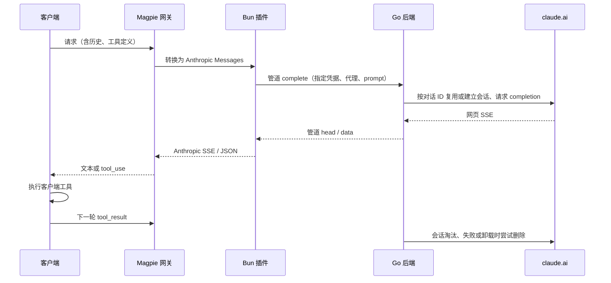

# 设计和边界

## 阅读原实现后的取舍

保留网页端组织发现、bootstrap 模型发现、创建/删除会话、completion SSE 和 Chrome TLS 指纹这些协议行为。重写文件布局、账号生命周期、错误传播、SSE 解析和客户端适配。

原实现的 `handlers/anthropic.go` 将工具定义注入文本，并在 `runToolLoop` 中执行服务端 Bash、Read、Write 等工具；这会在后端工作目录操作文件。新插件仅返回标准 `tool_use` 和 `stop_reason: tool_use`，接收客户端下一轮的 `tool_result`。Go 没有执行客户端命令的代码。

原实现的 SSE Scanner 没有把读错误和不完整结束明确传给协议层。新实现要求上游 `message_stop`；断流、无效 JSON、未完成工具调用和流中 error 都作为错误，不能同时发送成功的 `message_stop`。

原实现包含 HTTP 监听、环境变量凭据、多账号文本文件、磁盘配置以及账号池选择。插件使用 Magpie 提供的指定账号，将每次请求的凭据和有效代理通过管道传给 Go；后端只缓存该凭据的浏览器身份和连接，不重新选择账号。

## 调用路径

## 管道协议 v1

一行一个 UTF-8 JSON 对象，stdout 只输出协议，stderr 不转发到用户日志。后端先发 `{event:"ready",protocol:1}`。每个命令由插件生成随机 id：

- `models` → `{id,result:[modelID,...]}`。
- `complete` → `{id,event:"head",status:200}`，随后 `{id,event:"data",data:<网页事件>}`，结束 `{id,event:"done"}`。
- `abort` 取消同 id 的命令。
- `discard` 用原账号及代理清除指定 `completion.conversation_id`，包括已经完成但被本地解析器截断的会话。
- 错误 → `{id,error:{status,message,retryAfter?}}`，不包含 Cookie、上游正文或含凭据的代理 URL。

Go 限制并发执行为 16、在途命令为 64、内存账号客户端为 64。每次上游请求最多 5 分钟，模型发现单独设置 20 秒期限，远端会话删除最多 3 秒。Bun 限制单行为 4 MiB、每个消费者排队为 8 MiB；单个消费者超限后清空该队列、发送 abort 并返回错误，其他请求继续。无法信任管道帧或进程退出时才使整条桥接失效。

多组织账号读取账号组织列表后验证 `lastActiveOrg`。仅在列表包含该组织时采用浏览器提示，否则选择第一个非空组织；没有直接把 Cookie 中的组织值用于请求路径。

## 会话复用和账号保护

请求体 `conversation_id` 优先，否则使用 `chat.headers` 传来的宿主 session ID 摘要。插件为每个对话保存原 sessionKey 的 SHA-256 和代理，最多 1024 个绑定，按 30 分钟空闲期在下一次访问时淘汰；换账号或代理返回 409，不假装已替宿主调度器完成账号固定。

Go 的会话 map 按账号传输隔离，同账号串行执行，最多 16 个会话。新一轮使用上次请求指定的 assistant UUID 作为 parent。模型、上下文设置或历史前缀变化时重建。只存历史长度及 32 字节的前缀摘要，避免在多会话缓存中保留完整消息或长指纹数组；每轮仍发送完整序列化 prompt，与原项目行为保持一致。已完成请求的稳定摘要防止重复提交，不缓存重放响应正文。失败/取消则清除会话，避免从不确定的父消息继续。

本地停止词、预算和工具校验可能晚于上游完成，单纯取消管道请求无法撤销已提交的父消息。插件仅在完整翻译成功后允许保留会话；已经收到 head 但未完整交付时另发 discard，用原账号/代理串行清理已提交状态。每次请求携带独立 turn_key，迟到的 discard 只匹配自己的轮次，不能误删已成功续接的新一轮。head 前的拒绝（如重复请求的 409）保留原成功会话。清理信号与普通请求一样有边界，卸载仍会清理剩余的会话。

账号保护按 origin 和 sessionKey 共享，独立于完整 Cookie 和代理所用的传输实例。一次只处理一个模型发现或 completion 请求，完成后至少等待 1 秒。模型列表在内存缓存 60 秒。429 设置有界冷却，401/403 阻止当前进程中该 sessionKey 的后续请求；HTTP 错误页正文不读取，避免为了获取正文而延迟限流处理。SSE error 同样写入账号保护，不会误提交成功父消息。

保留会话在下次访问时进行空闲淘汰，或在退出时统一清理。退出清理最多 8 个 worker，共享 1.5 秒 deadline；已限制的账号不继续发送清理请求。所有本地会话和保护状态随进程退出消失。限制状态不落盘，不能承诺跨重启冷却或断电后的远端删除。

## 工具协议

每次请求产生随机 delimiter，降低引用历史中工具标记被误识别的机会。增量解析器保留跨 chunk 的 delimiter、JSON 字符串/转义状态，只在完整 JSON 和结束标记齐备后生成 `tool_use`。参数完成后才发出工具 JSON delta，不宣称参数本身来自原生逐 token 工具流。

随机 delimiter 不是 prompt injection 防护；模型仍可能不遵循文本协议。未知工具、非法 JSON、常见 schema 约束不匹配、tool_choice 不匹配和未完成调用明确失败。工具执行权限仍由客户端控制。

工具解析按需产出内容，停止词或输出预算已结束响应时，不继续解析同一片段后面的工具调用。工具大小限制只计算工具 JSON，不包含后续正常文本。schema 在发送 prompt 前检查本地引用，校验时限制递归深度和操作次数；支持范围见 README。

## 停止和输出预算

停止词匹配在可见文本上进行，暂存可能跨 delta 成为完整停止词的尾部；工具 JSON 不参与匹配，工具块边界会冲刷未匹配文本。匹配后不输出停止词和后续内容，取消上游并返回 `stop_sequence` 及命中的字符串。正常结束时补发暂存尾部。长重复前缀使用 KMP 前缀表避免反复进行平方量级的后缀比较。

文本长度和 usage 使用逐 Unicode 字符计数，避免为大字符串分配完整字符数组。输出预算优先于停止词；上游已明确返回的长度限制或拒绝原因保留。未命中停止词、也未主动达到输出预算的响应仍要求 `message_stop`，不能把断流视为成功。

## 后端生命周期

插件加载 → 检查能力标记、选项、二进制和校验和 → 启动一个受管后端 → 校验 ready。

账号登录/更新 → 下一次请求读取新凭据。内存缓存按凭据、origin、代理隔离，不生成文件。空闲旧账号可以被淘汰。

插件停止/宿主关闭 → 关闭管道 → 取消请求 → 有界尝试远端清理 → 关闭连接 → 退出。Bun 额外设置终止期限；即使 Bun 被强制结束，Go 也会检测 stdin EOF。

## 卸载

官方 Magpie 的 npm 卸载跳过脚本，且登录、模型和显示元数据位于共享存储；插件自身没有足够的正式生命周期接口完成彻底卸载。因此本项目通过显式能力握手依赖随附宿主补丁，而不是把不存在的接口当成已支持。

`package.json` 声明 `magpie.cleanRemove.providers`。宿主保留这份所有权，防止包删除到一半后无法重试。卸载验证 provider 是否与其他插件共享，停止当前和正在退出的旧宿主内该插件的后端，再清理指定账号、模型缓存、provider 元数据、包缓存和注册。其他插件的同名近似前缀数据保留。补丁没有对插件给出的任意路径执行递归删除。

卸载不能清除远端服务的历史、用户自己复制的 Cookie/源码、导出和备份。用户在 Magpie 中创建的路由组、历史请求与客户端绑定也由其所属功能管理，不作为插件私有文件擦除。这个范围必须在发布说明中写清，不能声称删除所有历史痕迹。
